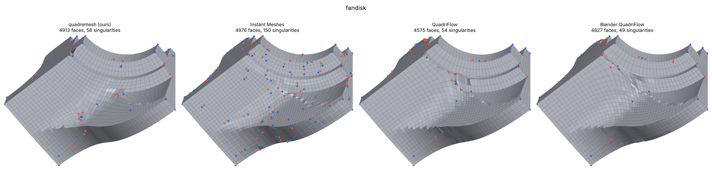
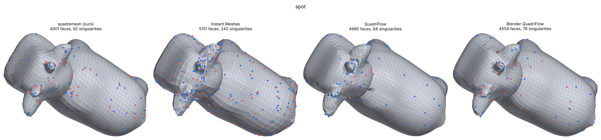
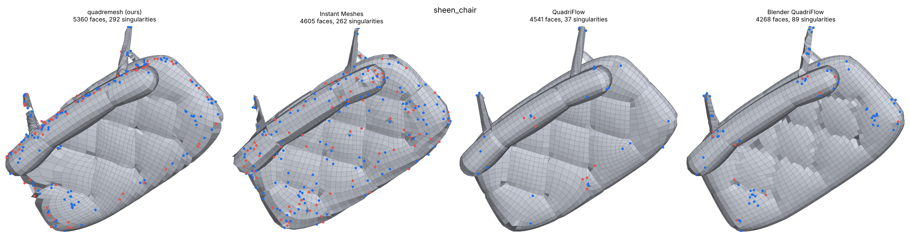

<h1 align="center">quadremesh</h1>

<p align="center"><b>Triangles in. Structured, feature-aligned quads out.</b><br>
A C++17 quad remesher with Python bindings, a CLI, an evaluator, and a reproducible 15-model benchmark.</p>

<p align="center">
  
  
  
  
  
</p>

<p align="center">
  <a href="docs/media/promo.mp4"></a><br>
  <sub>▶ Click for the full-quality video (<a href="docs/media/promo.mp4">promo.mp4</a>, 17 s). Left: input triangles. Right: our quads, singularities marked (blue valence 3, red valence 5+). Rendered by <code>benchmark/make_video.py</code>; every number in the video is read from the evaluator report.</sub>
</p>

## Results at a glance

<!-- GLANCE:BEGIN -->
| | target | result | |
|---|---|---|---|
| ✅ **Quad ratio** | ≥ 98 % | **100.0 %**, lowest model 100.0 % (99.1 % with max coverage) | met |
| ✅ **Mean scaled Jacobian** | ≥ 0.8 | **0.903**, every model ≥ 0.821 (Instant Meshes' lowest: 0.707) | met |
| ✅ **Mean distance error** | < 0.5 % | **0.086 %**, worst model 0.329 % (Instant Meshes 0.316 %) | met |
| ✅ **Fewer singularities than Instant Meshes** | equal face count | **14 / 15 models**, 3,276 vs 4,782 in total, 35.6 vs 99.8 per 1k faces | met |
| ✅ **Robustness** | 10+ diverse models | **15 / 15 models processed** incl. furniture and room-scale scans (QuadriFlow 12, Blender 8) | met |
| **Feature coverage** | ≥ 90 % | **≥ 90 % on 5 models** (fandisk, spot, sheen chair, velvet sofa, leather sofa); mean 73.1 %, 3.3× Instant Meshes (22.1 %) | met on fandisk, spot and 3 of 4 furniture models; limits measured in `docs/crease_bounds.md` |

Default setting for the first five rows; max-coverage setting for feature coverage. Generated by `docs/gen_tables.py`.
<!-- GLANCE:END -->

## Why it is different

- **Edges land on the creases.** Feature edges are traced, snapped and recovered as edge paths, so sharp edges stay sharp. Feature coverage against Instant Meshes is in the tables below.
- **Quality is measured, not claimed.** One evaluator (`quadeval`) scores quad ratio, scaled Jacobian, planarity, aspect, two-sided distance, feature coverage and singularities. Every table in this README is generated from its reports by `docs/gen_tables.py`.
- **Honest limits.** Models that miss 90 % keep their numbers in the tables, with the measured reasons in [`docs/crease_bounds.md`](docs/crease_bounds.md). No model was dropped, the metric was not relaxed, and failed experiments stay in [`docs/coverage_study.md`](docs/coverage_study.md).
- **Deterministic.** Same input, same output, bit for bit (checked by the test suite).

## Try it in two minutes

```bash
./scripts/fetch_deps.sh
cmake -S . -B build -DCMAKE_BUILD_TYPE=Release && cmake --build build -j4
cp build/_quadremesh*.so python/quadremesh/

build/quadremesh data/models/fandisk.obj -o out.obj -f 5000 -a 35 -v        # default
build/quadremesh data/models/fandisk.obj -o out.obj -f 5000 -a 35     --coverage-mode --path-subdiv 3 --sing-budget-im --coverage-search       # max coverage
build/quadeval data/models/fandisk.obj out.obj --target 5000 --feature-angle 35 -o report.json
```

```python
from quadremesh import quadremesh
res = quadremesh("chair.glb", target_faces=5000, feature_angle=35,
                 output="chair_quad.obj", report="chair.json")
print(res.quad_ratio, res.report["quality"]["scaled_jacobian"]["mean"])
```

Build note: use `-j4` on a 16 GB laptop (a full `-j12` build ran the machine out of memory), and pass
`-DCMAKE_POLICY_VERSION_MINIMUM=3.5` if your CMake is 4.x and the bundled lemon complains.

## See it

Each strip shows, left to right: quadremesh (ours), Instant Meshes, QuadriFlow, Blender QuadriFlow, at the same target face count. Dots are singularities (blue valence 3, red valence 5+).

<p align="center"><br><sub>fandisk (CAD part)</sub></p>
<p align="center"><br><sub>spot (organic)</sub></p>
<p align="center"><br><sub>sheen chair (furniture)</sub></p>

Full visual report for all 15 models: [`docs/report/visual_report.html`](docs/report/visual_report.html).

## GPU (CUDA) path, measured

The optional PyTorch components (`torch_field.optimize_field`, `learned.predict_guide_field`) run on CUDA and give the same field as on the CPU. Measured on a **GTX 1650 Ti (4 GB, sm_75) under WSL2**, torch 2.14.1+cu126, median of several runs after warm-up. Source: `scripts/cuda_check.py`, full output in [`docs/cuda_report.txt`](docs/cuda_report.txt).

| model | triangles | `optimize_field` CPU → CUDA | `predict_guide_field` CPU → CUDA | CUDA vs CPU field (p99 angle) | peak GPU memory |
|---|---|---|---|---|---|
| fandisk | 12,946 | 0.532 s → 0.599 s (0.89×) | 0.448 s → 0.581 s (0.77×) | 0.0000° | 52 MiB |
| igea | 268,686 | 15.158 s → 11.247 s (**1.35×**) | 9.887 s → 8.853 s (**1.12×**) | 0.0000° | 893 MiB |

Both runs end with `VERDICT: PASS`, and the remesh driven by the CUDA guide field keeps 100.0 % quads. The GPU only pays off on large meshes: on a small one the launch and transfer overhead make it slower. The remesher's own solver is C++ on the CPU, so the GPU does not change the coverage numbers above.

## Explore

| | |
|---|---|
| Interactive walkthrough (pipeline stage by stage, 3D viewer) | [`web/`](web/README.md), a React site deployable on Vercel (root directory `web`) |
| Architecture diagram | [`docs/architecture.html`](docs/architecture.html) |
| Technical write-up (PDF) | [`docs/technical_writeup.pdf`](docs/technical_writeup.pdf) |
| Every pipeline function with code and figure | [`docs/code_reference.md`](docs/code_reference.md) |
| The brief, line by line, against the repo | [`docs/assignment_coverage.xlsx`](docs/assignment_coverage.xlsx) |
| GPU (CUDA) check | [`docs/cuda_checklist.md`](docs/cuda_checklist.md) |
| Continue on another machine | [`CHECKPOINT.md`](CHECKPOINT.md) |

## Pipeline

| stage | what it does | where |
|---|---|---|
| 1. preprocess | weld, drop degenerate/duplicate faces, resolve non-manifold edges & vertices (best-pair gluing + fan splitting), consistent/outward orientation, fill small holes, drop tiny fragments | `src/preprocess.cpp` |
| 2. features | dihedral test + 1-ring and patch-scale tests (noise-robust), chaining, length pruning, corners; guidance strokes → edge paths | `src/features.cpp` |
| 3. field design | hard constraints: features, boundaries, strokes. soft guidance: principal curvature (scale-aware tensor fit), learned / external field; soft guidance is applied by an angle-limited pass so it cannot add singularities | `src/field.cpp`, `src/qflow_driver.cpp` |
| 4. sizing | target count or edge length; adaptive density map (per-vertex, sphere regions, curvature-driven) → scale field; **feature-adaptive size**: smaller elements along creases inside the solve, same face count | `src/field.cpp`, `src/remesh.cpp` |
| 5. integer grid + extraction | multiresolution orientation / position fields, min-cost-flow singularity optimisation, quad extraction (vendored, patched QuadriFlow); per connected component with coverage-checked retries for thin parts | `third_party/qflow_patched` |
| 5b. fallbacks | Instant Meshes extractor (second choice; best-of-two on dense scans), best approximate result for parts thinner than an element, QEM-decimated exact fallback | `src/im_driver.cpp`, `src/decimate.cpp` |
| 6. post-process | cleanup, triangle-pair merging, optional pure-quad split, feature/boundary/corner snapping, **feature edge-path recovery** (Dijkstra edge paths snapped onto every crease chain), optional feature refinement, guarded tangential relaxation + reprojection, untangling | `src/postprocess.cpp` |
| 6b. coverage stage | budgeted operations that put edges on uncovered creases: **near-miss snapping** (default), path-edge subdivision, loops, local refinement, curved splits, crease cuts (opt-in) | `src/remesh.cpp`, `src/crease_cut.cpp` |
| 7. symmetry | remesh one half (clipped at the plane, plane boundary preserved), mirror and weld | `src/preprocess.cpp`, `src/postprocess.cpp` |
| 8. attributes | per-corner UV transfer with UV-chart consistency; generic per-vertex attribute transfer | `src/transfer.cpp` |
| 9. report | quad ratio, scaled Jacobian, planarity, aspect, distance (mean / RMS / Hausdorff, two-sided), feature & boundary coverage, singularities / valence histogram, topology | `src/metrics.cpp` |

Deterministic: single-threaded solver, seeded PCG RNG, sort-based topology. The test suite checks
bit-identical output for repeated runs.

## Results (15-model benchmark, equal target face count)

<!-- SUMMARY:BEGIN -->
| criterion (mean over the models processed) | target | **quadremesh** (default) | quadremesh max coverage¹ | Instant Meshes | QuadriFlow | Blender QF |
|---|---|---|---|---|---|---|
| models processed | – | 15 / 15 | 15 / 15 | 15 / 15 | 12 / 15* | 8 / 15* |
| quad ratio (lowest model) | ≥ 98 % | 100.0 % (100.0 %) | 99.4 % (99.1 %) | 100.0 % (100.0 %) | 100.0 % (100.0 %)* | 100.0 % (100.0 %)* |
| mean scaled Jacobian (lowest model) | ≥ 0.8 | 0.903 (0.821) | 0.903 (0.821) | 0.935 (0.707) | 0.952 (0.895)* | 0.963 (0.930)* |
| mean distance error (highest model) | < 0.5 % | 0.086 % (0.329 %) | 0.082 % (0.329 %) | 0.316 % (3.421 %) | 0.054 % (0.092 %)* | 0.051 % (0.095 %)* |
| singularities / 1k faces | < IM | 35.6 | 40.8 | 99.8 | 17.8* | 17.3* |
| fewer singularities than IM, per model | all | 14 / 15 | 14 / 15 | – | 12 / 12 | 8 / 8 |
| total singularities, models both processed (method / IM) | < IM | 3276 / 4782 | 3754 / 4782 | – | 952 / 2922 | 629 / 1931 |
| feature coverage, all 15 models | ≥ 90 % | 66.9 % | 73.1 % | 22.1 % | 35.6 %* | 29.0 %* |
| feature coverage, 13 non-scan models | ≥ 90 % | 75.9 % | 82.8 % | 25.3 % | 35.6 %* | 29.0 %* |

\* over the models that method could process. ¹ `--coverage-mode --path-subdiv 3 --sing-budget-im --coverage-search` (§6.1). Generated by `docs/gen_tables.py` from `benchmark/results/reports/`.
<!-- SUMMARY:END -->

Two settings are reported. The **default** keeps every other criterion on every model (the
room scan's singularities excepted, see the write-up). **Max coverage** -
`--coverage-mode --path-subdiv 3 --sing-budget-im --coverage-search`
(Python: `coverage_mode=True, path_subdivision=3, sing_budget_im=True, coverage_search=True`) -
trades runtime (4 solves) and some element quality for feature coverage, while keeping quads
≥ 98 %, SJ ≥ 0.8, distance < 0.5 % and the singularity count below Instant Meshes'.

Feature coverage per model:

<!-- PERMODEL:BEGIN -->
| model | category | default | max coverage | Instant Meshes |
|---|---|---|---|---|
| bunny | organic scan | 0.71 | 0.81 | 0.10 |
| fandisk | CAD | 0.94 | 1.00 | 0.76 |
| fandisk_noisy | robustness | 0.83 | 0.85 | 0.37 |
| rocker_arm | CAD | 0.72 | 0.82 | 0.10 |
| armadillo | organic | 0.45 | 0.66 | 0.10 |
| spot | organic | 0.91 | 0.99 | 0.36 |
| beetle | CAD/vehicle | 0.75 | 0.79 | 0.12 |
| nefertiti | photogrammetry scan | 0.64 | 0.67 | 0.07 |
| igea | scan | 0.52 | 0.72 | 0.13 |
| sheen_chair | furniture | 0.93 | 0.93 | 0.48 |
| damask_chair | furniture | 0.68 | 0.68 | 0.30 |
| velvet_sofa | furniture | 0.88 | 0.92 | 0.39 |
| leather_sofa | furniture | 0.90 | 0.91 | 0.00 |
| fountain_scan | scene scan | 0.09 | 0.12 | 0.01 |
| lounge_room | room-scale scan | 0.08 | 0.09 | 0.02 |
<!-- PERMODEL:END -->

Every coverage experiment (25 iterations,
including the failed ones) is in the generated study [`docs/coverage_study.md`](docs/coverage_study.md)
(`python benchmark/coverage_study.py run NAME "FLAGS"` + `report`), and the geometric limits of the
metric - why the room scan cannot reach 90 % at 15k faces and why the organic scans need edges
shorter than the element size - are measured in [`docs/crease_bounds.md`](docs/crease_bounds.md)
(`python benchmark/crease_bounds.py`). `docs/technical_writeup.pdf` §6.1 has the analysis. Every pipeline function (file, signature, input, output, library, code excerpt, figure) is listed in [`docs/code_reference.md`](docs/code_reference.md), generated from the source by `docs/gen_codemap.py`.

### Feature coverage per model

<!-- COVSTATEMENT:BEGIN -->
**Feature coverage ≥ 90 % is reached on 5 of the 15 models**: fandisk 100.0 %, spot 99.4 %, sheen chair 92.9 %, velvet sofa 92.4 %, leather sofa 91.5 % (CAD, furniture, organic). 4 more are close, at 75-90 % (fandisk noisy 85.3 %, rocker arm 82.4 %, bunny 81.0 %, beetle 79.2 %). It is not reached on igea 72.2 %, damask chair 67.6 %, nefertiti 66.7 %, armadillo 66.2 % - organic scans whose creases zigzag below the element size, and dense carvings - nor on the two room scans (fountain scan 12.0 %, lounge room 8.5 %), whose 35° "creases" are scanner noise (both limits measured in `docs/crease_bounds.md`). Averaged over all 15 models coverage is 73.1 % (82.8 % without the room scans), against 22.1 % for Instant Meshes.
<!-- COVSTATEMENT:END -->

<!-- HEADLINE:BEGIN -->
| model | type | feature coverage, max coverage | ≥ 90 %? | default | Instant Meshes |
|---|---|---|---|---|---|
| fandisk | CAD | **100.0 %** | ✅ | 94.0 % | 76.1 % |
| spot | organic | **99.4 %** | ✅ | 91.4 % | 35.6 % |
| sheen_chair | furniture | **92.9 %** | ✅ | 93.2 % | 48.1 % |
| velvet_sofa | furniture | **92.4 %** | ✅ | 87.5 % | 39.0 % |
| leather_sofa | furniture | **91.5 %** | ✅ | 90.0 % | 0.3 % |
| fandisk_noisy | robustness | **85.3 %** | close | 83.1 % | 37.3 % |
| rocker_arm | CAD | **82.4 %** |  | 72.3 % | 9.8 % |
| bunny | organic scan | **81.0 %** |  | 71.4 % | 9.7 % |
| beetle | CAD/vehicle | **79.2 %** |  | 74.9 % | 12.2 % |
| igea | scan | **72.2 %** |  | 51.7 % | 13.2 % |
| damask_chair | furniture | **67.6 %** |  | 67.6 % | 30.2 % |
| nefertiti | photogrammetry scan | **66.7 %** |  | 63.9 % | 6.6 % |
| armadillo | organic | **66.2 %** |  | 45.3 % | 10.2 % |
| fountain_scan | scene scan | **12.0 %** |  | 8.6 % | 1.3 % |
| lounge_room | room-scale scan | **8.5 %** |  | 8.3 % | 1.5 % |

5 of 15 models reach ≥ 90 % feature coverage with the max-coverage setting; the best Instant Meshes result on any model is 76 %. Generated by `docs/gen_tables.py`.
<!-- HEADLINE:END -->

## Build

Requirements: CMake ≥ 3.16, a C++17 compiler, Boost headers (for QuadriFlow's lemon flow
solver), Python ≥ 3.9 with numpy for the bindings.

```
./scripts/fetch_deps.sh            # eigen, libigl, pybind11, cgltf, upstream QuadriFlow
cmake -S . -B build -DCMAKE_BUILD_TYPE=Release
cmake --build build -j
cp build/_quadremesh*.so python/quadremesh/      # or: pip install -e .
ctest --test-dir build                            # C++ tests
PYTHONPATH=python python -m pytest tests          # Python tests
```

## CLI

```
quadremesh INPUT(.obj|.ply|.glb|.gltf|.off) -o OUT.obj [options]
  -f/--faces N  -e/--edge-length X  -a/--feature-angle DEG  --min-feature-length K
  --feature-density K [--feature-density-width W]  --snap-near D  --path-subdiv K  --sing-budget-im
  --coverage-search  --legacy  --crease-cuts
  --coverage-mode  --feature-refine N  --feature-loops  --partial-loops  --curved-splits
  --trace-all  --tri-budget F  --sing-budget S  --refine-max-len K  --no-face-match
  --no-boundary  --curvature-weight W  --strokes FILE [--strokes-as-edges]
  --guide FILE [--guide-strength W]  --density FILE  --density-region X Y Z R F
  --curvature-density K  --symmetry x|y|z [--symmetry-offset C]
  --pure-quad  --smooth N  --no-uv  --report FILE.json  --field FILE  --seed S  -v

quadeval INPUT_TRI OUT_QUAD.obj [--target N] [--feature-angle DEG] [-o report.json]
```

Strokes file: one `x y z` point per line, blank line between strokes.

## Python API

`quadremesh(input, target_faces=5000, feature_angle=35, *, output=None, report=True,
target_edge_length=None, strokes=None, strokes_as_edges=False, density=None,
density_regions=None, curvature_density=0, symmetry_axis=None, guide_field=None,
guide_weight=None, learned_field=None, pure_quad=False, seed=0, **core_options)`
→ `QuadRemeshResult(vertices, faces, uv, report, timing, log, field, feature_edges)`.

`input` may be a path, a `(V, F)` tuple or any object with `.vertices/.faces` (e.g. trimesh).
`evaluate(input, quad)` scores any quad mesh with the same metrics.

Optional PyTorch modules (CUDA used automatically when available):

* `quadremesh.learned` - frame-equivariant graph network predicting a cross field + confidence
  from noisy geometry (`learned_field=True`); `python -m quadremesh.learned train|eval`.
* `quadremesh.torch_field.optimize_field` - sparse CG cross-field solver (smoothness +
  curvature alignment + hard feature constraints) on CPU or GPU, output usable as `guide_field`.

## Benchmark & report

```
python data/prepare_benchmark.py                 # build data/models from the downloads
python scripts/prepare_lounge.py <lounge.ply> data/models/lounge_room.obj
python benchmark/run_benchmark.py                # all methods, all models -> benchmark/results
python benchmark/make_report.py                  # figures + docs/report/visual_report.html
```

See `docs/technical_writeup.md` for design choices, results, failure cases and future work.

## Layout

```
include/quadremesh/   public headers           src/           core implementation
apps/                 CLI tools                python/        bindings + Python package
third_party/qflow_patched/  vendored QuadriFlow + PATCHES.md
benchmark/            runner, Blender script, report builder, results
data/                 benchmark/training model preparation + manifest
docs/                 write-up and visual report       tests/  C++ and Python tests
```

## Licenses

quadremesh code: MIT. Vendored QuadriFlow: its own license (`third_party/qflow_patched/LICENSE.txt`). Instant Meshes (fetched by `scripts/fetch_deps.sh`): BSD.
Benchmark models keep their original licenses (Stanford, Khronos sample assets, Open3D datasets).
