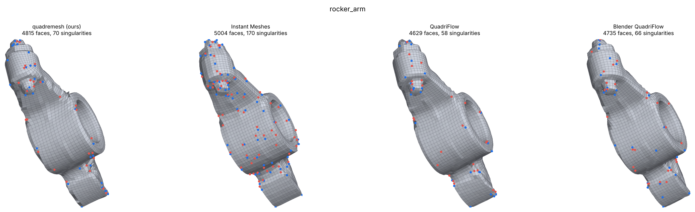

# quadremesh: code reference


Generated by `docs/gen_codemap.py` from the source: signatures and excerpts are copied from the files named.

### Libraries and what each one does here

| library | what it is | how it is used |
|---|---|---|
| Eigen 3 | header-only C++ linear algebra | Every mesh is stored as Eigen matrices (V: n×3 vertex positions, F: m×3 triangles, Q: k×4 quads); vectors, normals and the small least-squares systems in the field and relaxation code. |
| libigl | C++ geometry-processing library | AABB trees for closest-point queries (distance error, coverage test, projection onto the input surface, crease snapping) and the PLY reader. |
| QuadriFlow (vendored, 11 patches) | integer-grid quad solver, `third_party/qflow_patched` | Orientation field, position field, min-cost-flow singularity optimisation and quad extraction - the core solver. Patches: determinism, constraint bugs, external sharp edges / normals / scale, exceptions instead of exit(), bounded loops (`PATCHES.md`). |
| LEMON | graph library (inside QuadriFlow) | Network-simplex min-cost flow that QuadriFlow uses to move and cancel singularities globally. |
| Instant Meshes core | `imcore`, field-aligned remesher | Second extractor for parts QuadriFlow cannot solve (thin parts, the room scan), best-of-two on dense scans, and the internal reference for the singularity budget. |
| Intel TBB | parallel runtime (inside Instant Meshes) | Required by the Instant Meshes core; run single-threaded (nprocs = 1) for deterministic output. |
| Boost (headers) | C++ utilities | Required by LEMON's build. |
| cgltf | single-header glTF / GLB loader | Reads .gltf / .glb inputs (node transforms, UVs) in `src/io.cpp`. |
| pybind11 | C++ ↔ Python bindings | Builds the `_quadremesh` Python module from `python/bindings.cpp`; every remesher parameter is a keyword argument. |
| NumPy | Python arrays | Vertex / face arrays passed to and from the C++ core. |
| PyTorch | deep learning (optional component) | `python/quadremesh/learned.py`: a frame-equivariant graph network that predicts a guide field per vertex; runs on CUDA when available. |
| matplotlib, Pillow | plotting, images | `python/quadremesh/viz.py` and `benchmark/make_report.py`: the edge-flow / singularity / scaled-Jacobian / cross-field renders and the charts of the visual report. |
| trimesh, pymeshlab | Python mesh I/O and repair | Preparing the benchmark inputs (`data/prepare_benchmark.py`, `scripts/prepare_lounge.py`) and loading meshes in the Python scripts. |
| pynanoinstantmeshes, Blender | baselines | The Instant Meshes and Blender QuadriFlow runs of the benchmark (`benchmark/run_benchmark.py`, `benchmark/blender_quadriflow.py`). |
| markdown, WeasyPrint | documents | `docs/build_pdf.py` turns the write-up into the PDF. |

### Pipeline functions

#### Load: `load_mesh`

- **File:** `src/io.cpp`
- **Input:** file path (.obj / .ply / .glb / .gltf / .off)
- **Output:** TriMesh: V (n×3), F (m×3), optional UVs
- **What it does:** Reads any supported format into one triangle mesh; glTF node transforms are applied.
- **Library:** cgltf, libigl

```cpp
TriMesh load_mesh(const std::string& path)
```

#### Preprocess: `preprocess`

- **File:** `src/preprocess.cpp`
- **Input:** raw V, F (+ per-vertex attributes), Params
- **Output:** WorkMesh: clean, manifold, consistently oriented triangles
- **What it does:** Welds duplicate vertices, removes degenerate faces, repairs non-manifold edges and vertices, orients faces, fills small holes, drops debris.
- **Library:** Eigen

```cpp
WorkMesh preprocess(const MatrixXd& V, const MatrixXi& F, const MatrixXd& A, const Params& p, PrepStats& st)
```

#### Creases: `detect_features`

- **File:** `src/features.cpp`
- **Input:** V, F, angle threshold (35°), minimum chain length (3 L), support radius (L)
- **Output:** FeatureSet: sharp half-edges, crease segments, corner vertices
- **What it does:** Dihedral-angle test plus 1-ring and patch-scale tests, so scan noise is not a crease; chains shorter than 3 L are pruned.
- **Library:** Eigen

```cpp
FeatureSet detect_features(const MatrixXd& V, const MatrixXi& F, double angle_deg, double min_len, double support)
```


*Figure: `docs/report/fandisk_ours_panel.png` - creases (orange lines) and singularities on fandisk.*

#### Field constraints: `build_constraints`

- **File:** `src/field.cpp`
- **Input:** V, F, normals, crease flags, curvature, guide field, strokes
- **Output:** per-vertex direction + weight (hard on creases / boundaries, soft elsewhere)
- **What it does:** Turns creases, boundaries, curvature directions and the optional learned field into constraints for the cross field.
- **Library:** Eigen

```cpp
FieldConstraints build_constraints(const MatrixXd& V, const MatrixXi& F, const MatrixXd& N,
                                   const std::vector<int>& he_sharp, bool boundary_hard,
                                   const CurvatureInfo* curv, double curvature_weight, const MatrixXd* guide,
                                   const VectorXd* guide_w, double guide_strength,
                                   const std::vector<std::vector<Vector3d>>& strokes, double stroke_radius,
                                   double soft_fade)
```


*Figure: `docs/report/fandisk_ours_panel.png` - right panel: the cross field.*

#### Adaptive size: `density_to_scale`

- **File:** `src/field.cpp`
- **Input:** V, F, per-vertex density, max ratio (8)
- **Output:** per-vertex scale target with the same expected face count
- **What it does:** Converts the crease-distance density into the scale the field solve aims for (S = d^-1/2, normalised).
- **Library:** Eigen

```cpp
VectorXd density_to_scale(const MatrixXd& V, const MatrixXi& F, const VectorXd& density, double max_ratio)
```

Excerpt (`src/field.cpp`, line 218):

```cpp
    // S = d^-1/2, normalised so that sum A/S^2 == sum A  (same expected quad count)
    VectorXd S(nv);
    double num = 0;
    for (int i = 0; i < nv; ++i) { S[i] = 1.0 / std::sqrt(d[i]); num += A[i] / (S[i] * S[i]); }
    double k = std::sqrt(num / std::max(at, 1e-30));
```


*Figure: `docs/report/demo_density.png` - adaptive density.*

#### Integer grid: `run_quadriflow`

- **File:** `src/qflow_driver.cpp`
- **Input:** one connected component: V, F, constraints, scale, face budget, seed
- **Output:** QFResult: quad vertices and faces, field for visualisation
- **What it does:** Runs the patched QuadriFlow: orientation field, scale, position field, min-cost-flow singularity optimisation, extraction.
- **Library:** QuadriFlow, LEMON

```cpp
QFResult run_quadriflow(const QFJob& job)
```


*Figure: `docs/report/fandisk_ours_panel.png` - left panel: the extracted quads.*

#### Fallback extractor: `run_instant_meshes`

- **File:** `src/im_driver.cpp`
- **Input:** V, F (flat arrays), face count, crease angle
- **Output:** IMResult: pure quads
- **What it does:** Instant Meshes extraction for parts QuadriFlow cannot handle, and the reference for the singularity budget.
- **Library:** Instant Meshes core, TBB

```cpp
IMResult run_instant_meshes(const std::vector<double>& Vin, const std::vector<int>& Fin, int faces,
                            double crease_angle_deg, bool align_boundaries)
```

#### Whole pipeline: `quadremesh`

- **File:** `src/remesh.cpp`
- **Input:** input TriMesh + Params (target faces, feature angle, options)
- **Output:** Result: quad mesh, field, crease segments, log, timings
- **What it does:** Runs every stage per component, the coverage stage, the quality guard, face-count control and (optionally) the coverage search.
- **Library:** all of the above

```cpp
Result quadremesh(const TriMesh& input, const Params& p)
```


*Figure: `docs/report/charts.png` - per-method metrics across the benchmark.*

#### Crease paths + relaxation: `relax_and_project`

- **File:** `src/postprocess.cpp`
- **Input:** quad mesh, reference surface with creases, L, iterations
- **Output:** same mesh, vertices moved: edge paths snapped onto creases, smoothed, reprojected
- **What it does:** Directed-edge Dijkstra finds an edge path along every crease and snaps it on; then tangential relaxation and reprojection onto the input surface.
- **Library:** libigl (AABB)

```cpp
void relax_and_project(QuadMesh& m, const SurfaceRef& ref, double L, int iterations, PostStats& st)
```

Excerpt (`src/postprocess.cpp`, line 640):

```cpp
                double c = len * (1.0 + 6.0 * dm / L) + len * 1.5 * (1.0 - align);
                if (pu >= 0 && corner[u].count({std::min(pu, v), std::max(pu, v)})) c += 3.0 * L;
```

#### Near-miss snapping: `snap_near_creases`

- **File:** `src/crease_cut.cpp`
- **Input:** quad mesh, crease polylines, L, max distance (0.5 L), max angle (75°)
- **Output:** number of edges snapped; mesh vertices moved onto creases
- **What it does:** Moves both ends of an edge that runs beside an uncovered crease onto it, if quality and existing coverage hold.
- **Library:** libigl (AABB), Eigen

```cpp
int snap_near_creases(QuadMesh& m, const std::vector<std::vector<Vector3d>>& chains, double L, double max_dist,
                      std::vector<Vector3d>* moved, double max_angle)
```

Excerpt (`src/crease_cut.cpp`, line 727):

```cpp
        Vector3d qa = closest_on_chain(S[i].c, pa), qb = closest_on_chain(S[i].c, pb);
```


*Figure: `docs/report/sheen_chair_compare.png` - edge flow along the chair's piping.*

#### Path-edge subdivision: `subdivide_path_edges`

- **File:** `src/crease_cut.cpp`
- **Input:** quad mesh, crease edge paths, crease polylines, L, pieces (3), max edges
- **Output:** number of edges split; mesh with new crease vertices, still all quads
- **What it does:** Splits path edges whose chord misses a curved crease into three at crease points; each neighbouring quad becomes two quads.
- **Library:** Eigen

```cpp
int subdivide_path_edges(QuadMesh& m, const std::vector<std::vector<int>>& paths,
                         const std::vector<std::vector<Vector3d>>& chains, double L, int pieces, int max_edges,
                         std::vector<Vector3d>* added)
```

Excerpt (`src/crease_cut.cpp`, line 926):

```cpp
            // a quad that became a hexagon (a n1 n2 b c d) is split right here, with the diagonal
            // from n1 on one side and from n2 on the other, so no new vertex is left with valence 2
```



*Figure: `docs/report/rocker_arm_compare.png` - curved creases on the rocker arm.*

#### Coverage check: `uncovered_crease_runs`

- **File:** `src/crease_cut.cpp`
- **Input:** quad mesh, crease polylines, L, tolerances (0.1 L, 25°)
- **Output:** the crease pieces not yet covered (+ covered / total length)
- **What it does:** The evaluator's coverage test, used inside the pipeline to decide what to fix.
- **Library:** libigl (AABB)

```cpp
std::vector<std::vector<Vector3d>> uncovered_crease_runs(const QuadMesh& m,
                                                         const std::vector<std::vector<Vector3d>>& chains, double L,
                                                         double min_run, double pad, double tol, double max_angle,
                                                         double* covered, double* total)
```


*Figure: `docs/report/fandisk_compare.png` - fandisk, all methods.*

#### Scaled Jacobian: `scaled_jacobian`

- **File:** `src/metrics.cpp`
- **Input:** vertex positions, the 4 corner indices of a quad
- **Output:** number in [-1, 1]: worst corner's signed sine
- **What it does:** Shape quality of one quad; used by the evaluator, the quality guards and the snapping checks.
- **Library:** Eigen

```cpp
double scaled_jacobian(const MatrixXd& V, int a, int b, int c, int d)
```

Excerpt (`src/metrics.cpp`, line 30):

```cpp
    int q[4] = {a, b, c, d};
    Vector3d n = Vector3d::Zero();
    for (int k = 0; k < 4; ++k) {
        Vector3d e1 = V.row(q[(k + 1) % 4]) - V.row(q[k]), e2 = V.row(q[(k + 3) % 4]) - V.row(q[k]);
        n += e1.cross(e2);
    }
    double ln = n.norm();
    if (ln <= 0) return -1;
    n /= ln;
    double m = 1e9;
    for (int k = 0; k < 4; ++k) {
        Vector3d e1 = V.row(q[(k + 1) % 4]) - V.row(q[k]), e2 = V.row(q[(k + 3) % 4]) - V.row(q[k]);
        double den = e1.norm() * e2.norm();
        if (den <= 0) return -1;
        m = std::min(m, e1.cross(e2).dot(n) / den);
    }
    return m;
}
```


*Figure: `docs/report/fandisk_ours_panel.png` - middle panel: scaled-Jacobian heatmap.*

#### Evaluator: `evaluate`

- **File:** `src/metrics.cpp`
- **Input:** input triangles, output quads, EvalParams (angle 35°, target faces)
- **Output:** JSON report: quad ratio, SJ, distance, feature coverage, singularities, topology
- **What it does:** The one scoring function used by the CLI report, quadeval, the benchmark and the coverage search.
- **Library:** libigl (AABB), Eigen

```cpp
std::string evaluate(const TriMesh& input, const QuadMesh& out, const EvalParams& ep, double runtime, const std::string& method)
```

Excerpt (`src/metrics.cpp`, line 367):

```cpp
        J.num("feature_coverage", ft > 0 ? fc / ft : 1.0);
```

#### UV transfer: `transfer_uvs`

- **File:** `src/transfer.cpp`
- **Input:** input mesh with UVs, output quads
- **Output:** output quads with per-corner UVs
- **What it does:** Each quad samples the UV chart under its centroid, so faces never straddle a seam.
- **Library:** libigl (AABB)

```cpp
void transfer_uvs(const TriMesh& src, QuadMesh& out)
```


*Figure: `docs/report/demo_uv_purequad.png` - UV transfer and pure-quad output.*

#### Python API: `quadremesh`

- **File:** `python/quadremesh/api.py`
- **Input:** path / (V, F) / mesh object, target_faces, feature_angle, options
- **Output:** QuadRemeshResult: V, Q, UV, quality report
- **What it does:** Python front end; keyword options map one-to-one to the C++ Params.
- **Library:** pybind11, NumPy

```python
def quadremesh(input: MeshLike, target_faces: int = 5000, feature_angle: float = 35.0, *,
               output: Optional[str] = None, report: Union[bool, str, None] = True,
               target_edge_length: Optional[float] = None, strokes: Optional[Sequence[np.ndarray]] = None,
               strokes_as_edges: bool = False, density: Optional[np.ndarray] = None,
               density_regions: Optional[Sequence[Tuple[Sequence[float], float, float]]] = None,
               curvature_density: float = 0.0, symmetry_axis: Union[str, int, None] = None,
```

#### Learned field: `predict_guide_field`

- **File:** `python/quadremesh/learned.py`
- **Input:** V, F, checkpoint, device
- **Output:** per-vertex guide direction + confidence
- **What it does:** Optional PyTorch component: predicts a guide field that the remesher uses as soft guidance; CUDA when available.
- **Library:** PyTorch

```python
def predict_guide_field(V, F, checkpoint: Optional[str] = None, device="auto", feature_angle=35.0):
```

