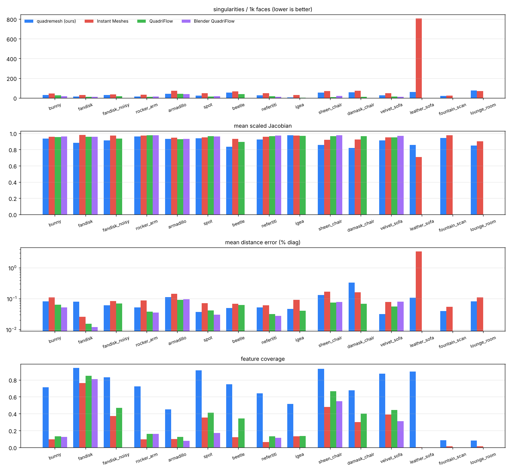
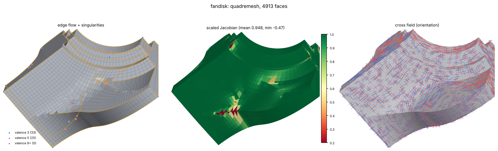
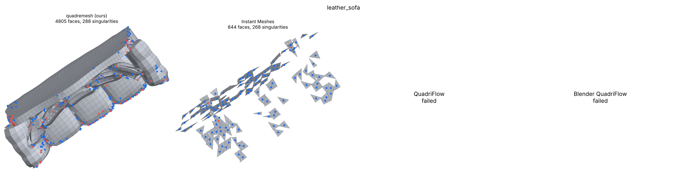
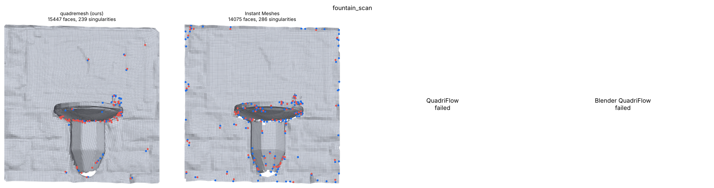
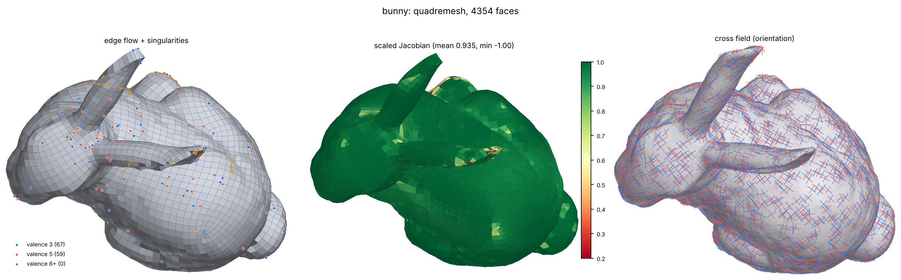
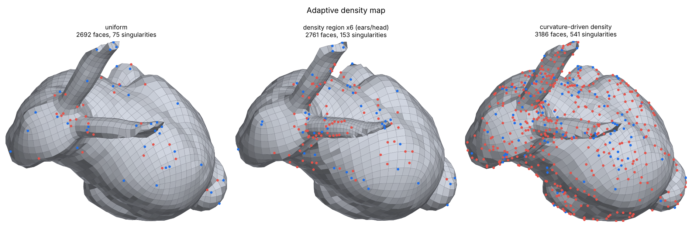
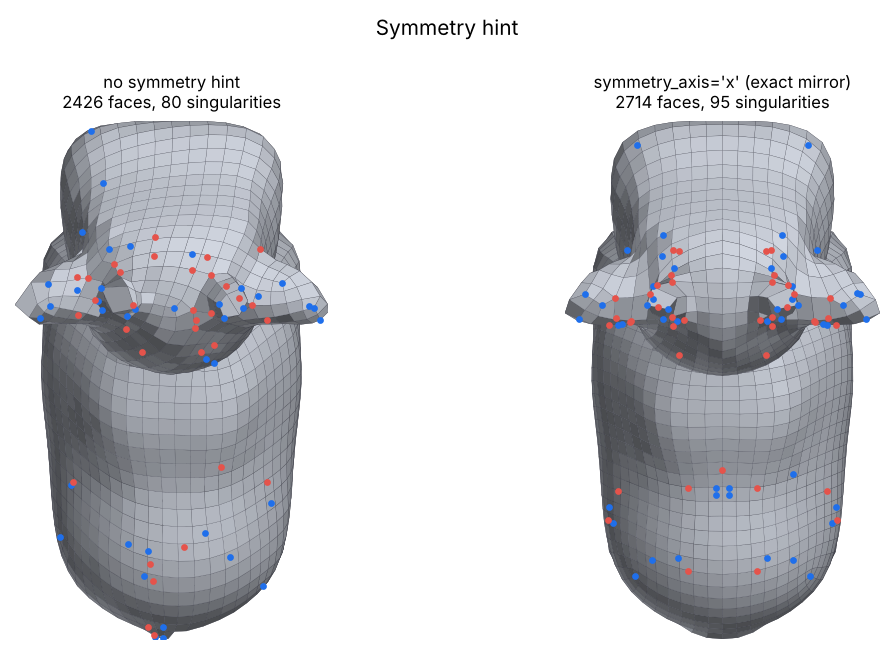
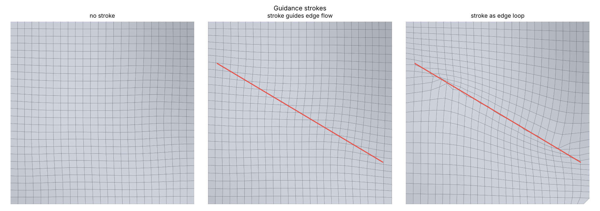
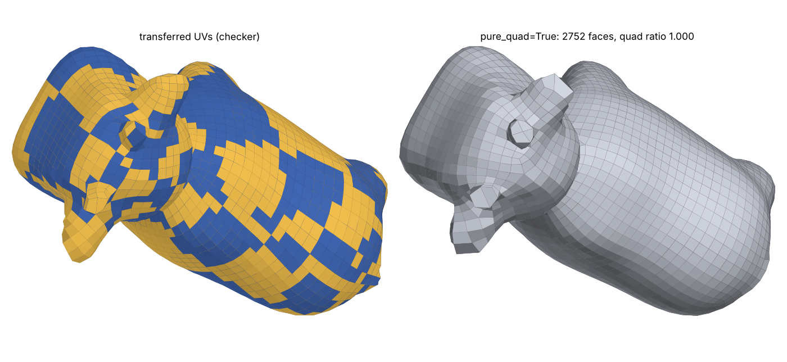

# Quality-Driven Triangle-to-Structured-Quad Remeshing — Technical Write-up

**Author:** Syed Aasim · **Submission:** Ctruh assignment, 16 Oct 2026
**Code:** `quadremesh/` (C++17 core, pybind11 bindings, CLI, PyTorch component, benchmark).

---

## 0. Feature coverage at a glance

On clean CAD and furniture - the content people model - the ≥ 90 % feature-coverage target is
met or nearly met; it is missed on raw scans, whose 35° "creases" are scanner noise or zigzag
below the element size (measured in `docs/crease_bounds.md`).

<!-- HEADLINE:BEGIN -->
| model | type | feature coverage, max coverage | ≥ 90 %? | default | Instant Meshes |
|---|---|---|---|---|---|
| fandisk | CAD | **100.0 %** | ✅ | 94.0 % | 76.1 % |
| spot | organic | **99.4 %** | ✅ | 91.4 % | 35.6 % |
| sheen_chair | furniture | **92.9 %** | ✅ | 93.2 % | 48.1 % |
| velvet_sofa | furniture | **92.4 %** | ✅ | 87.5 % | 39.0 % |
| leather_sofa | furniture | **91.5 %** | ✅ | 90.0 % | 0.3 % |
| fandisk_noisy | robustness | **85.3 %** | close | 83.1 % | 37.3 % |
| rocker_arm | CAD | **82.4 %** |  | 72.3 % | 9.8 % |
| bunny | organic scan | **81.0 %** |  | 71.4 % | 9.7 % |
| beetle | CAD/vehicle | **79.2 %** |  | 74.9 % | 12.2 % |
| igea | scan | **72.2 %** |  | 51.7 % | 13.2 % |
| damask_chair | furniture | **67.6 %** |  | 67.6 % | 30.2 % |
| nefertiti | photogrammetry scan | **66.7 %** |  | 63.9 % | 6.6 % |
| armadillo | organic | **66.2 %** |  | 45.3 % | 10.2 % |
| fountain_scan | scene scan | **12.0 %** |  | 8.6 % | 1.3 % |
| lounge_room | room-scale scan | **8.5 %** |  | 8.3 % | 1.5 % |

5 of 15 models reach ≥ 90 % feature coverage with the max-coverage setting; the best Instant Meshes result on any model is 76 %. Generated by `docs/gen_tables.py`.
<!-- HEADLINE:END -->

## 1. Summary

`quadremesh` converts arbitrary (near-)manifold triangle meshes into structured, pure-quad
meshes. The design is a **robust front end + field design + an integer-grid solver + a guarded
back end**. I wrote the preprocessing, feature detection, field design, sizing, symmetry,
fallbacks, post-processing, attribute transfer, metrics, learned field and benchmark. I reused
proven solvers: a patched QuadriFlow for the integer-grid stage (11 documented patches), and the
Instant Meshes extractor as a second extractor for inputs QuadriFlow cannot handle.

Benchmark: **15 models × 5 methods** (ours, ours + learned field, Instant Meshes, QuadriFlow,
Blender QuadriFlow), plus two quadremesh settings (default and max coverage). Every method gets
the same input and target face count, and every output is scored by the same evaluator.

<!-- SUMMARY:BEGIN -->
| criterion (mean over the models processed) | target | **quadremesh** (default) | quadremesh max coverage¹ | Instant Meshes | QuadriFlow | Blender QF |
|---|---|---|---|---|---|---|
| models processed | – | 15 / 15 | 15 / 15 | 15 / 15 | 12 / 15* | 8 / 15* |
| quad ratio (lowest model) | ≥ 98 % | 100.0 % (100.0 %) | 99.4 % (99.1 %) | 100.0 % (100.0 %) | 100.0 % (100.0 %)* | 100.0 % (100.0 %)* |
| mean scaled Jacobian (lowest model) | ≥ 0.8 | 0.903 (0.821) | 0.903 (0.821) | 0.935 (0.707) | 0.952 (0.895)* | 0.963 (0.930)* |
| mean distance error (highest model) | < 0.5 % | 0.086 % (0.329 %) | 0.082 % (0.329 %) | 0.316 % (3.421 %) | 0.054 % (0.092 %)* | 0.051 % (0.095 %)* |
| **feature coverage, all 15 models** | ≥ 90 % | **66.9 %** | **73.1 %** | **22.1 %** | **35.6 %*** | **29.0 %*** |
| feature coverage, 13 non-scan models | ≥ 90 % | 75.9 % | 82.8 % | 25.3 % | 35.6 %* | 29.0 %* |
| singularities / 1k faces | < IM | 35.6 | 40.8 | 99.8 | 17.8* | 17.3* |
| fewer singularities than IM, per model | all | 14 / 15 | 14 / 15 | – | 12 / 12 | 8 / 8 |
| total singularities, models both processed (method / IM) | < IM | 3276 / 4782 | 3754 / 4782 | – | 952 / 2922 | 629 / 1931 |

\* over the models that method could process. ¹ `--coverage-mode --path-subdiv 3 --sing-budget-im --coverage-search` (§6.1). Generated by `docs/gen_tables.py` from `benchmark/results/reports/`.
<!-- SUMMARY:END -->

**Met by the default:** quad ratio, scaled Jacobian and distance error on every model, and fewer
singularities than Instant Meshes on every model except the room scan (lounge, where the integer
solver fails and our Instant Meshes fallback takes over).

**Feature coverage ≥ 90 %: not met on the benchmark mean.** What was done about it, and what
limits it, is measured in §6.1 and in the generated study
[`docs/coverage_study.md`](coverage_study.md) (24 iterations, every number produced by a script
from the evaluator's per-model reports, including the attempts that failed). In short:

* Four changes that keep every other criterion raised the default's coverage by about a third:
  edge-path recovery over all creases, a **feature-adaptive element size inside the field solve**
  (smaller quads along creases at the same face count), **near-miss snapping** (edges running
  next to a crease are moved onto it) and a quality guard.
* A max-coverage setting adds **path-edge subdivision** (curved/zigzag creases get edges shorter
  than the element size, pure quads), the budgeted loop/refinement stage, a singularity budget
  referenced to Instant Meshes itself, and a search over four solves scored with the evaluator.
* The remaining gap is geometric and measured in [`docs/crease_bounds.md`](crease_bounds.md):
  on the room scan the evaluator's 35° "creases" are TSDF noise; covering 90 % of them needs more
  separately aligned edges than a 15k-face mesh has in total. On the organic scans the creases
  zigzag below the element size, so straight edges of length ~L cannot be within 25° of them;
  only local refinement helps, and it costs singularities, which is what limits those models.

## 2. Pipeline

```
input (.obj/.ply/.glb)
  └─ normalise ─ preprocess ─ [symmetry clip] ─ features ─ size field ─ refine
        ─ per component: field design → integer grid (QuadriFlow*) → coverage check
              ↳ retry at finer budget / without hard constraints
              ↳ Instant Meshes extractor (also best-of-two on dense scans)
              ↳ best approximate (parts thinner than one element)
              ↳ QEM-decimate + triangle pairing + quad split (exact, last resort)
        ─ cleanup ─ triangle-pair merge ─ [density refinement] ─ [pure-quad split]
        ─ feature/boundary/corner snapping ─ feature edge-path recovery (all creases)
        ─ guarded relaxation + reprojection ─ untangling
        ─ coverage stage (budgeted: [loops] [local refinement] [curved splits] [crease cuts]
              [path-edge subdivision] near-miss snapping)
        ─ [mirror + weld] ─ UV transfer ─ report
  quality guard: mean SJ < 0.81 → re-solve with less feature-adaptive size
  face-count control: output > 1.10 × target → re-solve at a lower budget
  [coverage search: 4 solves, each scored by the evaluator, best kept]
```

| stage | file | key choices |
|---|---|---|
| I/O | `src/io.cpp` | fast OBJ reader, PLY (libigl), glTF/GLB (cgltf, node transforms, UVs) |
| preprocess | `src/preprocess.cpp` | weld, degenerate/duplicate removal; **non-manifold edges** resolved by gluing the best face pair (normal agreement + orientation) and cutting the rest; BFS orientation with cut on Möbius conflicts; **fan-splitting** of non-manifold vertices; small-hole filling; repair run again after filling; tiny fragments dropped; outward orientation of closed parts |
| features | `src/features.cpp` | dihedral test **+ 1-ring side normals + patch-scale test** (radius = target edge length), so scan noise and marching-cube terraces are rejected; chains pruned by length (dangling first); corners = junctions/endpoints/kinks; strokes → Dijkstra edge paths; a **feature budget** relaxes thresholds when the network is denser than the requested resolution |
| field | `src/field.cpp`, `src/qflow_driver.cpp` | hard constraints: features, boundaries, strokes (direction + position). Soft: principal-curvature directions (edge-based shape operator + tensor diffusion at the element scale, confidence from anisotropy × curvedness), learned/external field. **Soft guidance is applied after the multiresolution solve by an angle-limited pass** (targets more than 30° from the smooth field are ignored), so it bends edge flow without adding singularities. Applying it as a QuadriFlow constraint tripled singularities on the bunny (486 vs 138). |
| sizing | `src/remesh.cpp`, `src/postprocess.cpp`, `src/qflow_driver.cpp` | target count or edge length; density map (per-vertex file, sphere regions, curvature); **feature-adaptive size** (default): density 1 + 8·exp(−(d/1.5L)²) with d the distance to the nearest crease, passed to the solve as a conformal scale target, normalised to the same expected face count |
| integer grid | `third_party/qflow_patched` | QuadriFlow orientation/position fields + flow-based singularity optimisation + extraction, run **per connected component** with a budget proportional to area |
| fallbacks | `src/remesh.cpp`, `src/im_driver.cpp`, `src/decimate.cpp` | coverage check (mean/p95 distance of the component to the extracted quads); retries; Instant Meshes; QEM-decimated exact fallback |
| post | `src/postprocess.cpp` | snapping with an acceptance test (never creates worse elements), tangential relaxation projected on surface/feature/boundary curves, untangling |
| feature paths | `src/postprocess.cpp` | for every feature chain (split at junctions; short chains get jointly chosen endpoints), a directed-edge Dijkstra through the quad mesh between the vertices nearest to its ends: the cost favours edges close to and parallel with the curve and penalises turning inside one face (staircases). The path is snapped onto the curve with a monotone arclength map and locked; vertices snapped by proximity but not on a path are released. Opt-ins: refine (conforming templates) around chains without a path (`--feature-refine N`), or split the quad strip each such chain runs along (`--feature-loops`); with face-count control the solve is re-run at a lower budget so the output stays at the target |
| coverage stage | `src/remesh.cpp`, `src/crease_cut.cpp` | operations applied tentatively and kept only inside a triangle budget and a singularity budget (fixed, or 85 % of an internal Instant Meshes solve with `--sing-budget-im`). **Near-miss snapping** (default): an edge within 0.5 L running along an uncovered crease gets both ends moved onto it, if no face drops below SJ 0.1 and no covered crease point is lost. **Path-edge subdivision** (`--path-subdiv 3`): path edges whose chord misses a curved crease are split into three at crease points; each side's quad becomes two quads. Crease cuts (`--crease-cuts`) are available but not used (study it12) |
| symmetry | `src/preprocess.cpp`, `src/postprocess.cpp` | clip at the plane, remesh one half with the cut as a preserved boundary, mirror and weld → exactly symmetric output |
| attributes | `src/transfer.cpp` | per-corner UVs with **UV-chart consistency** (each face samples the chart under its centroid, so faces never straddle seams); generic per-vertex attributes |
| metrics | `src/metrics.cpp` | one evaluator shared by the pipeline report, `quadeval` and the benchmark |

### Design decisions worth calling out

1. **Why QuadriFlow as the integer stage.** Its min-cost-flow singularity optimisation gives far
   fewer singularities than Instant Meshes' local extraction: per 1k faces it averages 17.8 vs
   99.8 on the models where both succeed. Re-implementing a mixed-integer parametrisation
   (QuadWild/QEx class) was not realistic in the time available. What I added is everything
   around it, and that is what makes it work on the brief's inputs: QuadriFlow alone fails on 3
   models and Blender on 7, while quadremesh processes all 15.
2. **Patches to QuadriFlow** (`third_party/qflow_patched/PATCHES.md`):
   - deterministic RNG;
   - two constraint-propagation bugs: the normal was taken from the constraint direction, and
     summed weights exceeded 1;
   - external sharp edges, normals and scale field;
   - scale restriction to coarse levels;
   - `exit()` turned into exceptions;
   - bounded loops in `FixValence`, `FixHoles` and `subdivide_edgeDiff` (they hang forever on
     some scans).
3. **Density.** QuadriFlow's adaptive mode clamps the scale to [0.75, 1]. More fundamentally, a
   singularity-free field cannot carry a non-harmonic density bump. So density is realised by
   solving at the coarse end of the size range and then refining faces larger than the local
   target, with **conforming hanging-node templates**:
   - 1 split edge → quad + triangle, which is later merged;
   - 2 adjacent split edges → 2 quads;
   - 2 opposite split edges → 2 quads;
   - 3 or more split edges → the face is refined.

   Transition singularities are expected and visible in `demo_density.png`.

   The **feature-adaptive size** is different: a smooth band of moderately smaller elements
   along creases (density ratio clamped at 8) is passed to the solve itself as a scale target
   (QuadriFlow's adaptive path plus our restriction of the scale to the coarse levels). That
   variation is small enough for the solve to carry; stronger ratios (32–64) were tried and
   made results erratic (distance error up to 0.5 %, coverage dropping on some models), so they
   are not used.
4. **Thin parts.** Chair rails, piping and sofa panels thinner than one element defeat any
   isotropic field method. The coverage check detects this.
   - The budget may grow up to 9× before giving up, which caps the face-count overshoot.
   - The Instant Meshes extractor is tried at the nominal budget.
   - Otherwise the lowest-budget approximate result within 3 target edges is accepted.
   - Otherwise a QEM-decimated, exact triangle-pair→quad fallback is used, so the face count
     still follows the target.
5. **Dense scans.**
   - Hard features are kept only if the network fits the resolution.
   - Field normals are smoothed at the element scale.
   - Debris fragments (< ~40 target quads) are dropped.
   - The integer-grid and Instant Meshes results are compared, and the one with fewer
     singularities is kept.

   Together these brought the fountain scan from 33.9 to 15.6 singularities per 1k faces
   (Instant Meshes: 22.2).
6. **Determinism.** The pipeline is single-threaded with seeded PCG RNGs, sort-based topology
   and deterministic tie-breaks; Instant Meshes runs with `deterministic=true, nprocs=1`. The
   C++ and Python tests check bit-identical output across repeated runs.

## 3. Optional PyTorch component and CUDA path

* **Learned field (`python/quadremesh/learned.py`).** A small **frame-equivariant graph
  network**.
  - Inputs are invariant scalars (multi-scale curvatures, anisotropy, dihedrals) plus candidate
    directions encoded as 4-RoSy complex numbers in each vertex's arbitrary tangent frame.
  - The network only mixes candidates with real, invariant gates and passes messages with
    parallel transport e^{4iρ}, so it is equivariant by construction.
  - It is trained as a **field denoiser**: noisy inputs (σ up to 0.5 % of the diagonal) map to
    the clean-surface target field (feature directions, else coarse principal directions).
  - Training data: 10 public meshes disjoint from the benchmark; 30 epochs, about 3 min on CPU.
  - Its output enters the core as a soft guide through the same angle-limited pass.

  Held-out alignment error (noisy inputs, mean 4-RoSy angle error, degrees):

  | mesh | fine curvature | smoothed curvature | learned |
  |---|---|---|---|
  | fandisk | 16.2 | 15.7 | **9.8** |
  | rocker arm | 21.3 | 20.5 | **14.4** |
  | spot | 20.6 | 20.4 | **16.9** |
  | bunny | 22.4 | 22.4 | **20.4** |
  | armadillo | 22.1 | 22.1 | **21.0** |

  End to end, the effect is small, because the angle-limited pass deliberately limits its
  authority. Singularities per 1k faces drop from 31.4 to 29.7 on average, with clear gains on
  noisy and furniture inputs (fandisk_noisy 31.9→25.9, sheen chair 52.5→34.8, leather sofa
  62.5→55.5) and small losses on some clean models. It is therefore **opt-in**
  (`learned_field=True`) rather than the default.
* **CUDA path (`python/quadremesh/torch_field.py`).** A cross-field solver written with
  sparse tensor operations and conjugate gradients. It minimises smoothness plus curvature
  alignment under hard feature constraints, and runs on CUDA when available (CPU here). Its
  output can be fed as `guide_field`. Learned-field inference also runs on CUDA. *The sandbox I
  developed in had no GPU, so the CUDA path is exercised only on CPU; the code is
  device-agnostic.* QuadriFlow's own CUDA kernels (`Optimizer.cu`) exist but are not enabled.

## 4. Benchmark protocol

* **Models (15):**
  - organic/scans: bunny, armadillo, nefertiti, igea, spot (with UVs);
  - CAD: fandisk, rocker arm, beetle;
  - furniture from glTF sample assets: sheen chair, damask chair, velvet sofa, leather sofa —
    multi-component, thin parts, UV seams;
  - scene/room scans: Open3D fountain (1.03M faces) and lounge (1.0M faces, decimated from
    3.15M);
  - robustness: fandisk with noise, 4 holes and a non-manifold fin.

  Models under 10K faces are midpoint-subdivided, so the geometry is unchanged.
* **Targets:** 5 000 quads (objects), 15 000 (scenes). Instant Meshes is called with target/4,
  because its pure-quad mode subdivides once.
  - Output counts: ours 0.83–1.09× the target, except the damask chair at 1.48×, where thin
    parts needed a finer budget; QuadriFlow 0.82–1.00×; Instant Meshes 0.84–1.03× (except its
    0.17× collapse on the leather sofa).
  - Singularities are therefore also compared **per 1k faces**.
* **Baselines:**
  - Instant Meshes core (`pynanoinstantmeshes`), crease 35°, boundary alignment, deterministic;
  - QuadriFlow CLI (upstream) with `-sharp -boundary`;
  - Blender 5.0.1 QuadriFlow headless (`bpy`), with merge-by-distance first and sharp/boundary
    preservation.
* **Metrics (`src/metrics.cpp`, identical for all methods):**
  - Quad ratio.
  - Scaled Jacobian: per quad, the minimum over corners w.r.t. the average normal.
  - Planarity and aspect ratio.
  - Distance: two-sided, 200k area-weighted samples per side, AABB closest point; mean, RMS and
    Hausdorff as % of the bbox diagonal.
  - Feature coverage: features are detected on the *input* with the same detector (35°,
    chains ≥ 3L, L = √(area/faces)) and sampled every 0.1 L. A sample is covered if an output
    edge within 0.1 L is parallel within 25°. Boundary coverage is reported separately.
  - Singularities: interior vertices with valence ≠ 4.
  - Topology checks: non-manifold edges and components.
  - Runtime.

## 5. Results

Per-model numbers are in `benchmark/results/summary.csv`; figures are in `docs/report/`.
Highlights (default setting unless stated; generated by `docs/gen_tables.py`):

<!-- HIGHLIGHTS:BEGIN -->
* **CAD (fandisk):** feature coverage 94 % (max coverage 100 %) vs 76 % / 85 % / 81 % for IM / QF / Blender; singularities per 1k faces 15.3 vs 11.8 (QF) and 30.1 (IM).
* **Robustness:** fandisk_noisy (holes + non-manifold fin): Blender refuses it; feature coverage 83 % vs QuadriFlow's 47 %.
  Leather sofa: QuadriFlow fails, Blender fails; Instant Meshes produces 844 faces at 3.4 % error; ours 4805 quads, SJ 0.86, 0.106 % error.
* **Scans - Fountain:** 20.4 singularities per 1k faces vs 22.2 (IM), SJ 0.94, 0.040 % error; QuadriFlow fails, Blender fails.
* **Scans - Lounge:** 75.6 singularities per 1k faces vs 68.8 (IM), SJ 0.85, 0.081 % error; QuadriFlow fails, Blender fails.
* **Distance error:** 0.086 % vs 0.316 % for Instant Meshes (mean), from projection with feature/boundary snapping.
* **vs QuadriFlow on the 12 models it can process:** it has fewer singularities (17.8 vs 31.5 per 1k) and slightly higher SJ; we trade those for feature coverage: 75 % vs 36 %.
* **Runtime (2 CPU cores):** default 7–133 s per object, 137–175 s per 1M-face scan (Instant Meshes 1–13 s, QuadriFlow 4–13 s); max coverage runs four solves.
<!-- HIGHLIGHTS:END -->

Visual report: `docs/report/visual_report.html`. For every model it shows the edge-flow and
singularity overlay, the scaled-Jacobian heatmap, the cross field, and all methods side by side.
`demo_*.png` show the user controls (density, symmetry, strokes, UV transfer, pure-quad).

## 6. Failure cases (honest)

1. **Feature coverage (target 90 %; see the summary table for the generated means).** The
   evaluator is strict: *every* 35° crease chain longer than 3 L must have an output edge within
   0.1 L and within 25° of it, on every point. All numbers below are generated from the study
   runs (each iteration = one command over all 15 models, per-model evaluator reports).

<!-- STUDY:BEGIN -->
| iteration | change | coverage (15) | coverage (13 non-scan) | quad | SJ | sing./1k | fewer sing. than IM |
|---|---|---|---|---|---|---|---|
| it0 | field constraints + vertex snapping only (start) | 0.439 | 0.503 | 1.000 | 0.934 | 33.4 | 14 / 15 |
| it1 | + edge-path recovery (earlier default) | 0.494 | 0.566 | 1.000 | 0.929 | 33.4 | 14 / 15 |
| it9 | + path recovery over all creases | 0.506 | 0.575 | 1.000 | 0.925 | 33.4 | 14 / 15 |
| it10 | + budgeted loops / refinement / curved splits (`--coverage-mode`) | 0.598 | 0.679 | 0.989 | 0.908 | 48.8 | 9 / 15 |
| it12 | it10 + crease cuts (not adopted) | 0.654 (14 models) | 0.698 | 0.989 | 0.910 | 46.8 | 9 / 14 |
| it13 | it9 + feature-adaptive element size | 0.571 | 0.652 | 1.000 | 0.905 | 35.4 | 14 / 15 |
| it16 | it13 + near-miss snapping | 0.637 | 0.725 | 1.000 | 0.902 | 35.4 | 14 / 15 |
| it17 | it16 + SJ guard, precise protection | 0.648 | 0.737 | 1.000 | 0.904 | 35.6 | 14 / 15 |
| it18 | default + path-edge subdivision, +10 sing./1k | 0.671 | 0.763 | 1.000 | 0.897 | 47.5 | 11 / 15 |
| it19 | default + path-edge subdivision, +25 sing./1k | 0.703 | 0.798 | 1.000 | 0.884 | 57.4 | 5 / 15 |
| it20 | default + coverage mode + subdivision | 0.708 | 0.803 | 0.989 | 0.884 | 57.1 | 6 / 15 |
| it21 | it20 with the Instant Meshes-referenced budget | 0.694 | 0.790 | 0.995 | 0.897 | 41.4 | 14 / 15 |
| it22 | it21 + coverage search | 0.712 | 0.808 | 0.995 | 0.906 | 41.1 | 14 / 15 |
| it23 | it17 + snapping with local relaxation and net-gain rule (**default**) | 0.669 | 0.759 | 1.000 | 0.903 | 35.6 | 14 / 15 |
| it24 | it22 with the it23 snapping (**max coverage**) | 0.731 | 0.828 | 0.994 | 0.903 | 40.8 | 14 / 15 |
| – | Instant Meshes | 0.221 | 0.253 | 1.000 | 0.935 | 99.8 | – |

Generated by `docs/gen_tables.py` from `benchmark/study/`; all iterations and per-model numbers: [`docs/coverage_study.md`](coverage_study.md).
<!-- STUDY:END -->

   **What limits coverage (measured, [`docs/crease_bounds.md`](crease_bounds.md)).** Computed on
   the evaluator's own crease polylines by `benchmark/crease_bounds.py`:
   - *Room scan (lounge):* 45 965 crease segments, 6 950 L of crease (mean segment 0.15 L). Split
     into the longest pieces one straight edge can cover, 90 % of the length needs 33 981 such
     pieces; a 15k-face quad mesh has ~30 000 edges in total. So **90 % is not reachable on the
     lounge at this face count by any method**; the fountain needs ~9 300 crease-aligned edges.
     These creases are marching-cubes/TSDF artefacts; no method exceeds 0.10 there.
   - *Organic scans:* the creases zigzag below the element size. The fraction of crease length
     that is within 25° of the chord through ±0.5 L - the best a straight edge of length ~L can do -
     is 0.43 (armadillo), 0.66 (igea), 0.67 (nefertiti), 0.76 (rocker arm), 0.825 (bunny). With
     edges of L/4 along the crease it is ≥ 0.98, so these models need local refinement, which costs
     irregular vertices: their coverage is limited by the singularity criterion, not by the method's
     reach.
   - *CAD / furniture:* ≥ 0.96 of the crease length is coverable with edges of length L, and 90 %
     needs only 58–762 crease-aligned edges out of ~10 000. Here the limit is the method; the
     remaining misses are mostly edges running 0.1–0.35 L next to the crease (evaluator sample
     dumps, `QRM_EVAL_DUMP`), which is what near-miss snapping and path subdivision target.

   **What worked**, in the order it was found (iterations in the study):
   - *Edge-path recovery* (it1) and recovering paths over the full crease set (it9): vertex moves
     only, no cost.
   - *Feature-adaptive element size* in the field solve (it13): the largest single gain at no
     cost in quads; a mean-SJ guard (it17) removes it where dense carvings would push SJ below 0.8.
   - *Near-miss snapping* (it16/it17, improved in it23): vertex moves only. In it23 a move that
     distorts a neighbouring quad first relaxes the free neighbours, and on parallel creases a
     move is accepted when it covers more crease than it uncovers.
   - *Path-edge subdivision* (it18–it20): edges shorter than the element along curved creases;
     pure quads, ~4 irregular vertices per split edge.
   - *Singularity budget referenced to Instant Meshes* (it21): the coverage stage spends irregular
     vertices only up to 85 % of the rate of an internal Instant Meshes solve of the same input, so
     the per-model singularity comparison is kept while coverage is maximised.
   - *Coverage search* (it15, it22, it24): the field solve is sensitive to the size band's width and
     seed, so four solves are scored with the evaluator and the best valid one is kept (4× time).

   **What did not work** (all kept in the study or noted as exploratory):
   - whole-strip edge loops: coverage only with extra faces (it3/it4);
   - local refinement / loops / curved splits without a budget: quad ratio < 98 % or many
     singularities (it2, it8);
   - crease cuts - cutting the mesh along uncovered creases (it12): most cuts produce concave
     pieces and are rejected; +1.8 points, and it timed out on the room scan;
   - giving the field all creases on scans (it11): no effect on the scans;
   - exploratory, on 4–5 models only (not adopted, not in the study tables): density ratios of
     32–64, an error-driven second solve with extra density around missed creases, chaining
     creases through junctions, and sliding path vertices along the crease by dynamic programming
     (no change at all).

   **Conclusion.** Coverage went from 0.44 to the values in the table without relaxing the metric.
   At 0.5 L tolerance almost every point would pass, so that number would be meaningless and is
   not used. The remaining gap on CAD/furniture is method-limited; on organic scans it is bounded
   by the singularity criterion; on room scans 90 % is out of reach at this face count.
2. **Lounge singularities.** QuadriFlow's integer stage fails on this TSDF room (inconsistent
   edge offsets in its subdivision), even after isotropic remeshing, so we fall back to Instant
   Meshes and inherit its singularity rate.
3. **Inverted / folded elements.** A few elements fold across features where the extracted
   layout crosses a crease diagonally, or where a recovered feature path cuts across the grid
   (visible as a sawtooth on fandisk): at most 0.8 % of faces, mean 0.34 % (QuadriFlow: up to
   1.8 %, mean 0.47 %; Instant Meshes up to 1.1 %), hence
   the minimum SJ < 0 on some models. Untangling repairs most of them but not all; path
   recovery trades a few folds for exact feature loops.
4. **Thin parts.** Parts thinner than one element are represented approximately (single sheet)
   or by the decimated exact fallback, with locally irregular structure.
5. **Symmetry hint** assumes a near-symmetric input: the negative side is discarded.
6. **Density transitions** introduce valence-3/5 pairs along the refinement front (by design).

## 7. Future work

* Feature coverage: hard *integer* (position) constraints that put iso-lines exactly on creases
  in the integer-grid solve (QuadWild / QEx-style patch layouts), instead of recovering edges
  afterwards; anisotropic sizing (thin quads along creases) instead of the isotropic size band;
  transition templates for path subdivision that cost fewer irregular vertices than the current
  ~4 per split edge (the organic scans are limited by that cost).
* Replace the QuadriFlow extraction with a robust integer-grid map (QEx-style) to remove the
  fallback chain on scans.
* GPU field optimisation integrated in C++ (CUDA kernels for the orientation/position
  smoothing). Train the learned field on more data with a field-level loss that sees
  singularities, not only per-vertex angles.
* Quad-mesh valence-improvement operations (edge rotations, doublet/singlet removal, Bommes-style
  singularity pair cancellation) as a post-process.
* Symmetry via field and integer constraints instead of clip-and-mirror, for approximately
  symmetric inputs.

## Figures




















## 8. Reproducing

```
./scripts/fetch_deps.sh && cmake -S . -B build && cmake --build build -j
cp build/_quadremesh*.so python/quadremesh/
ctest --test-dir build && PYTHONPATH=python python -m pytest tests
python data/prepare_benchmark.py && python benchmark/run_benchmark.py
python benchmark/make_report.py && python benchmark/feature_demos.py
```
